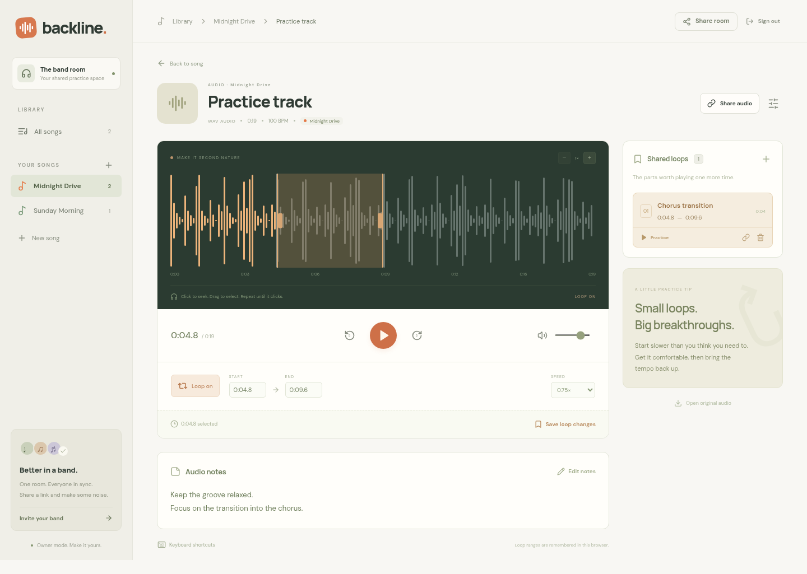

# Backline

A small, self-hosted practice room for your band. Organize the library by song, attach audios, add rehearsal notes, and practice tricky sections in a waveform player.

**Bandmates don’t need accounts. Only the owner can change the shared library.**

## Preview



*Shown with demo data.*

## Start locally

Requires Node.js **22.13+** (Node 24 LTS recommended).

```bash
cd ~/Projects/band-practice
npm install
npm run setup
npm run build
npm start
```

Open **http://localhost:3001**. On another device on the same network, use `http://<this-computer's-LAN-IP>:3001`.

`npm run setup` creates a private, gitignored `.env` file with a random owner password. Read or change `OWNER_PASSWORD` there, then use **Owner sign in** in the app. Passwords must be at least 12 characters. The setup command will never overwrite an existing `.env`.

For development, run `npm run dev` and open **http://localhost:5173**. Vite proxies the API and audio to port 3001.

## What you can do

The library shows **songs, not individual files**:

1. Create a song, such as **SONG1**.
2. Open it and use **Add audio** to attach audios.
3. Select an audio to open its waveform player and saved loops.

**Song notes** apply to all audios. **Audio notes** and loop ranges belong to an individual audio. To move an audio to a different song, open its player, choose **Edit audio details**, and change **Song**.

| Feature | Bandmate | Owner |
| --- | --- | --- |
| Browse, search, and listen to songs | Yes | Yes |
| Read song-level notes, audio notes, and shared loops | Yes | Yes |
| Drag or type a loop range for personal practice | Yes | Yes |
| Change speed (0.5×–1.5×, preserving pitch), volume, and zoom | Yes | Yes |
| Share the room, a song, or a saved loop by link | Yes | Yes |
| Create/rename songs, attach/move audios, and set audio names/BPM | — | Yes |
| Edit rehearsal notes | — | Yes |
| Create, update, or delete shared loops | — | Yes |
| Delete audios | — | Yes |

- Upload multiple files with progress and individual error reporting, up to **150 MB per file**.
- MP3, WAV, M4A, FLAC, OGG, Opus, AAC, AIFF, and WebM extensions are accepted. Actual playback depends on your browser’s codecs; **MP3 or PCM WAV are the safest choices across devices**. The app does not transcode audio.
- Try an original, synthesized demo groove from an empty song in owner mode. The demo is a real audio file, is never added automatically, and can be deleted.
- Drag the selection handles to resize a loop, drag its middle to move it, or drag outside it to select a new range. Click the waveform to seek. The loop toggle controls whether playback repeats.
- Each audio’s last loop start/end and loop-on/off setting are remembered in a **functional browser cookie**, including for listeners who are not signed in. Ranges survive reloads and reopening the audio in the same browser, without changing the shared library.
- The cookie lasts up to one year, remembers up to the 32 most recently used audios (fewer if needed to stay below the cookie size limit), and uses Secure on HTTPS and SameSite=Lax. Clearing/blocking cookies or using another browser/device removes or separates these personal preferences; playback still works without cookies.
- Explicit shared-loop links take precedence over a browser’s remembered range. Named shared loops remain in the database and are still owner-managed.
- Song links show all audios; audio and loop links reopen the right player and selection. Links shared before the song-first update continue to work. Playback requires a click; it does not autoplay.
- Library changes refresh in other browsers every 15 seconds. Notes are saved explicitly, not on every keystroke.
- Deleting an audio keeps its parent song and other audios. Explicitly deleting a song permanently deletes **all its audios, notes, and saved loops**, with a confirmation showing the number of audios affected.
- For safety, an older cached client cannot delete a nonempty song without the new explicit all-audios confirmation.
- Existing groups migrate to song containers. Previously ungrouped files each receive a song container, with original audio, IDs, audio notes, and loops preserved.

### Keyboard shortcuts

| Key | Action |
| --- | --- |
| Space | Play / pause |
| L | Toggle looping |
| `[` / `]` | Set loop start / end at the playhead |
| Left / right arrow | Seek backward / forward 5 seconds |

Shortcuts do not intercept text entry or dialog controls.

## Sharing beyond your home network

The local address is **not** an online deployment. Run the app on a server reachable by your band and put it behind an **HTTPS reverse proxy**, then share that URL. Don’t send your owner password with the listening link.

- Listen access is public to anyone who can reach the server: audio, notes, group names, and saved loops are **not private**. Public listening is intentional; links are not access tokens.
- Owner mutations are enforced on the server, not just hidden in the UI.
- Owner sessions use random tokens in HttpOnly, SameSite=Strict cookies. Password checks use scrypt and constant-time comparison; sign-in is rate-limited. Sessions last up to seven days, live in server memory, and are invalidated by a server restart.
- Use HTTPS before signing in over the internet. If exactly one trusted reverse proxy is in front of the app, set `TRUST_PROXY=1` and `COOKIE_SECURE=true`. Do not enable proxy trust when exposing the server directly.
- If using Nginx, raise `client_max_body_size` to at least `160m` to allow the largest uploads. Caddy’s default reverse proxy supports these uploads without that setting.
- If `OWNER_PASSWORD` is unset, the server runs **read-only**, with owner sign-in disabled. To change a forgotten password, edit `.env` and restart.

### Docker

First create `.env` with `npm run setup`, or copy `.env.example` and set a strong `OWNER_PASSWORD`. Then:

```bash
docker compose up --build -d
```

The app listens on port **3001**. The named `backline-data` volume stores the database and audios. Do not remove that volume unless you intend to delete the library.

Docker requires only Docker/Compose on the host; Node is only needed if you use the setup script instead of editing `.env` yourself.

## Data and backups

By default all shared data lives in `data/`:

```text
data/
  backline.sqlite       # song containers, audios, notes, and loop ranges
  backline.sqlite-wal   # SQLite may create WAL/SHM files while running
  backline.sqlite-shm
  uploads/              # original audio under generated filenames
```

For a consistent backup, stop the app and back up the **whole `data/` directory** (or Docker volume). Restore it to the same location before restarting. Keep `.env` separately and privately. Don’t copy only the SQLite file while the app is running.

Environment variables:

| Variable | Default | Purpose |
| --- | --- | --- |
| `OWNER_PASSWORD` | unset | Owner password, minimum 12 characters; unset = read-only |
| `PORT` | `3001` | API and production website port |
| `HOST` | `0.0.0.0` | Listening interface; use `127.0.0.1` for local-only access |
| `DATA_DIR` | `./data` | Persistent database and uploads, relative to the working directory |
| `TRUST_PROXY` | unset | Set `1` only behind one trusted reverse proxy |
| `COOKIE_SECURE` | unset | Set `true` to require HTTPS for the owner cookie |

Existing environment variables take precedence over `.env`. Run commands from the project directory.

## Checks

```bash
npm test
npm run build
npm run test:e2e
```

API/unit tests cover read-only permissions, login/logout, forged cookies, rate limiting, upload cleanup, byte-range playback, metadata validation, persistent groups/loops, and deletion behavior.

Migration tests cover legacy groups becoming song containers, automatic grouping of previously ungrouped files, retention of IDs/notes/loops, and idempotent startup. Legacy database/API names (`groups` for song containers and `songs` for audios), internal recording names, and the `recording` URL parameter are intentionally retained to preserve deployed data and older links; the UI consistently uses songs and audios.

Browser tests use system Chromium (`/usr/bin/chromium`, or set `CHROMIUM_PATH`). They exercise real uploads, waveform selection, repeated playback, speed changes, sharing links, notes, owner permissions, and a mobile listener. They run against isolated temporary databases under `/tmp/opencode` and save screenshots under `/tmp/opencode/backline-screenshots`.

Optional checks against **your own** HTTPS instance require an explicit target:

```bash
node scripts/check-deployment.mjs https://music.example.com
node scripts/check-live-browser.mjs https://music.example.com
```

Alternatively, set `BACKLINE_URL` for those scripts. They use the owner password from local `.env` or `OWNER_PASSWORD`, sign in and out, and do not edit shared library content. Instance-specific infrastructure and operator notes are kept outside the public source; there is no built-in deployment address.

## Stack and scope

React + TypeScript + Vite, WaveSurfer.js, Express, and Node’s built-in SQLite. Fonts are bundled locally; there are no analytics, external APIs, or cloud-storage requirements.

Designed for a small band, with a single owner and one app server. Waveforms are decoded in the browser; very long recordings can use substantial memory. Loop playback uses browser media seeking, so it is **not a sample-accurate DAW or a synchronized group-listening session**. The whole original audio file is loaded to generate its waveform.
